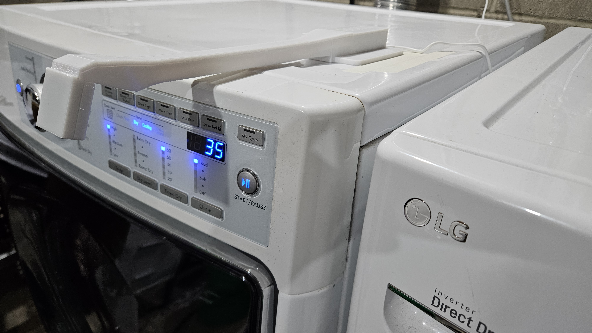

# Appliance Display Sensor

Read an appliance's countdown with a Raspberry Pi camera, show it in Home Assistant,
and optionally ask a Google/Nest speaker how much time remains.

See the [in-use photo and setup-page gallery](docs/in-use.md) for alignment,
camera controls, sensor health and segment detection. The
[assembly photos](hardware/mount/photos/README.md) show the printed parts and electronics.

**Status: experimental release candidate, prepared 2026-11-11.** The reference dryer
has completed real MQTT/HA cycles, and Google has answered on the speaker asked.
The owner reports the physical checks were completed on the reference installation.
A fresh independent installation and isolated recovery checks remain open. This is
not a universal display reader or a certified Works with Google product.

[Download the mount and print profile on MakerWorld](https://makerworld.com/en/models/3591988-appliance-display-sensor-pi-camera-mount)

## Choose your starting point

| Component | Start here |
| --- | --- |
| Pi camera reader and calibration page | [Pi setup](software/appliance-display-sensor/docs/raspberry-pi-setup.md) |
| Printed mount and case, five current parts | [Print and assembly guide](hardware/mount/README.md) |
| Home Assistant MQTT entities and notifications | [HA setup](docs/home-assistant.md) |
| Optional Google replies on the speaker asked | [Self-hosted bridge](software/google-runcycle-bridge/docs/self-hosted-setup.md) |
| Checks before calling this tested | [Physical test checklist](docs/physical-tests.md) |
| Known limitations and release gates | [Release status](docs/release-status.md) |

The local sensor uses MQTT and needs no Google account. The optional bridge runs
on HA OS and needs your own Google developer integration and HTTPS address.
It is read-only and does not operate the appliance. Adaptive countdown increases
and decreases are accepted; completion requires a configured terminal display.

## Repository layout

- `software/appliance-display-sensor/`: Pi source, tests, setup scripts and HA blueprints.
- `software/google-runcycle-bridge/`: optional bridge, HA apps, installer and tests.
- `hardware/mount/`: final five matching STLs, supplied 3MF, STEP design files and build photos.
- `docs/`: installation entry points, validation and publishing instructions.
- `tools/build_artifacts.py`: rebuild public source and MakerWorld ZIPs from an explicit manifest.

Clone [jasonnovak/appliance-display-sensor](https://github.com/jasonnovak/appliance-display-sensor)
or download a package from [Releases](https://github.com/jasonnovak/appliance-display-sensor/releases).
After cloning or extracting, enter `software/appliance-display-sensor` before
running its setup commands. The repository root itself is not a Python package.
Use the Pi OS packages for Picamera2 as described in the setup guide.

## License

Original software and software documentation: [Apache-2.0](LICENSE).
Mount/case designs and their documentation: [CERN-OHL-P-2.0](hardware/mount/LICENSE).
The [MakerWorld model listing](https://makerworld.com/en/models/3591988-appliance-display-sensor-pi-camera-mount) additionally offers the model under
Creative Commons Attribution (CC BY); see that listing for its license terms.
See [NOTICE](NOTICE). Third-party components keep their original licenses.

## Contributing and publishing

See [CONTRIBUTING.md](CONTRIBUTING.md). Current scope is a calibrated fixed
seven-segment countdown display, Raspberry Pi Zero 2 W/Camera Module 3 Standard,
and Home Assistant MQTT. Other displays and hosts need their own validation.
Publishing destinations and the remaining operator checks are in
[publishing](docs/publishing.md).
