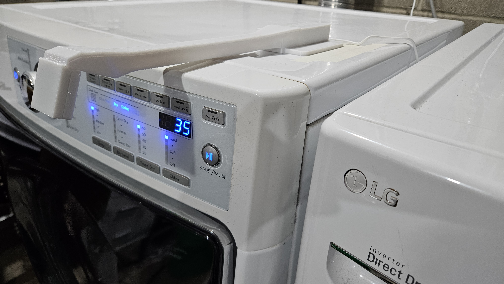
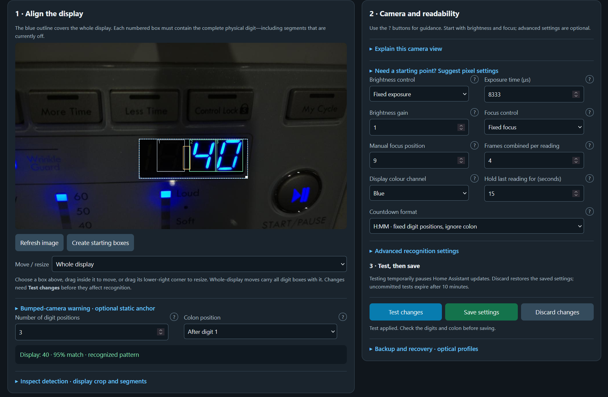
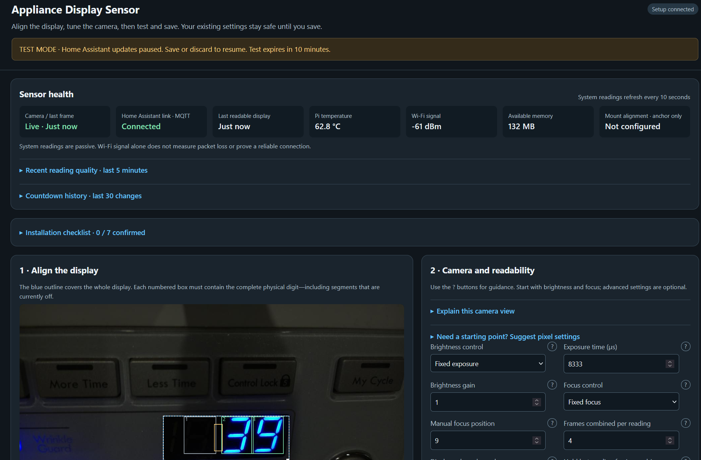
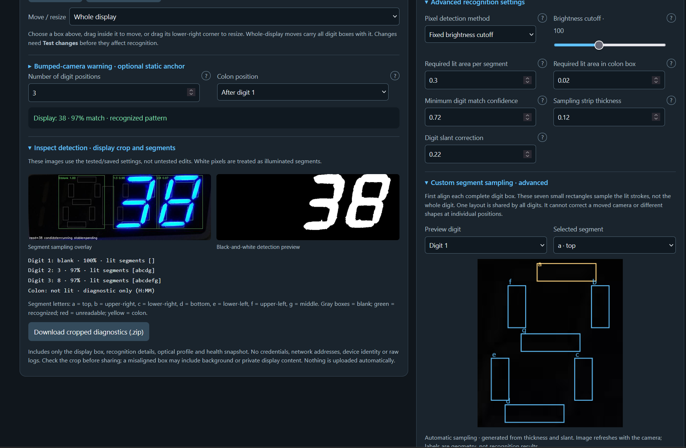

# Appliance Display Sensor in use

These photos and screenshots show the reference dryer installation. Camera settings,
digit positions and readings are examples, not universal defaults for other appliances.

## Installed mount

The camera faces the countdown display from the end of the printed arm. The Pi and
ribbon cable are enclosed, with the power cable routed back across the appliance top.

See the [print and assembly guide](../hardware/mount/README.md) and
[assembly photo gallery](../hardware/mount/photos/README.md) for the parts and cable routing.

## Alignment and camera controls

The setup page lets you position the whole-display and individual-digit boxes,
adjust exposure and focus, and test changes before saving. This example reads
40 minutes and uses fixed-position H:MM decoding, which does not depend on the colon.

## Sensor health

The health panel shows camera freshness, MQTT connection, the last readable frame,
Pi temperature, Wi-Fi signal and available memory. The screenshot was taken in
test mode: Home Assistant reading updates are temporarily paused until settings
are saved, discarded or the test expires. Its values are a snapshot, not a current
status report or recommended operating targets.

## Inspecting recognition

The cropped overlay and black-and-white preview show what the reader samples.
Per-digit results list the illuminated segments, while advanced controls allow
threshold, slant and segment-sampling adjustments. This example recognizes 38;
the unlit colon is diagnostic only in H:MM mode.

Start with [Pi setup](../software/appliance-display-sensor/docs/raspberry-pi-setup.md)
and [Home Assistant setup](home-assistant.md). The photographs and screenshots do
not replace the remaining [physical validation checks](physical-tests.md).
