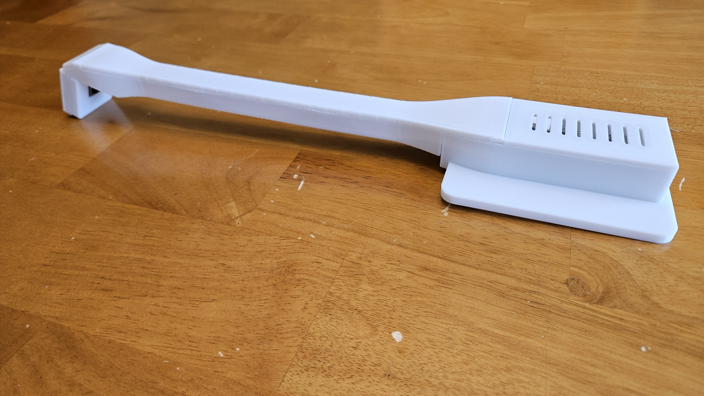

# Appliance Display Sensor mount and case

## Supplied print project and photos

The [Bambu Studio 3MF](print-project/appliance-display-mount.3mf) is the supplied
final H2C project. All five model parts match the corresponding final STLs below;
vertex positions, triangle connectivity and winding were checked. See
[project settings and mesh verification](print-project/README.md).
The [photo gallery](photos/README.md) shows the supplied printed assembly, covers,
electronics and camera end. The owner reports physical checks completed on the
reference installation; no independent thermal/vibration qualification is claimed.

## Final standalone STL/CAD set

Current print set: **recessed-head base, Pi lid, thicker-front camera cover,
closed-end cable cover and overlap-nose arm**. Designed around a
Pi Zero 2 W, Camera Module 3 Standard and a 300 mm Standard-to-Mini ribbon cable.
Check the printer-specific slice and fit for your own installation.

| Part in `stl/` | Printing orientation / support starting point |
| --- | --- |
| 01-base-recessed-head.stl | Flat underside down; Pi compartment up; inspect opening supports |
| 02-pi-lid.stl | Supplied outer-face-down orientation; inspect preview |
| 03-camera-cover-thicker-front.stl | Supplied outer-face-down orientation; inspect preview |
| 04-curved-cover-closed-end.stl | Supplied near-upright long-edge pose; automatic tree supports |
| 05-main-arm-overlap-nose.stl | Supplied 4-degree lengthwise pitch/45-degree diagonal yaw; normal automatic snug supports |

Import separately at 100% scale into a new slicer project and preserve the supplied
orientations. Select your actual printer and filament profiles. STLs contain no
support settings, pauses or temperature settings. Inspect support, brim and tower
clearance. A short neck test used four walls and 15% gyroid; that is not full-arm
strength qualification. Use the intended interface-material settings; do not copy
zero support gaps from a dedicated-interface-material test into same-material PETG.

## Hardware and assembly

- Six 10 x 3 mm magnets in the enclosed base pockets.
- One M3 x 8 mm socket-head cap screw and ordinary M3 hex nut, no washer.
- Pi Zero 2 W, Camera Module 3 Standard, 300 mm Standard-to-Mini camera cable,
  microSD and suitable Pi power supply; check enclosure/heatsink clearance.

The base includes the corrected SD opening and deeper screw-head recess. Its
nominal screw-head clearance below the contact plane is 1.0 mm. With the screw
gently snug, confirm actual clearance using a straightedge on a protected work
surface before placing it on an appliance. Clear support debris; do not overtighten.
Check the cable isn't pinched or taut, all covers fit and the camera cannot shift.
Power down and disconnect Pi power before connecting or reseating the camera cable.

## Required magnet pause

The pocket floor is Z=0.4 mm and roofs start at Z=3.7 mm. With 0.20 mm first and
subsequent layers and no raft, pause **before layer 19 / displayed Z=3.8 mm**, after
the last open layer at Z=3.6 mm. Verify all six pockets remain open in the actual
slice. Insert each magnet fully below the next extrusion path with the intended
polarity before continuing. Changing layer heights/raft requires finding the pause
again from the preview. This pause is not stored in the STL.

## CAD and revision identity

`cad/` contains the five corresponding STEP exports in assembly coordinates;
the STLs use print orientations. These STEP files come from the revision folders
whose STL exports match the final set byte-for-byte. An old merged FreeCAD assembly
was excluded because it predates the revised arm and covers. A full parametric
feature history is not supplied. `mesh-verification.json` records the final 3MF/STL
comparison and source hashes. Older variants, diagnostic pieces and machine-ready
G-code are excluded.

See `SHA256SUMS.json` in the built mount ZIP for integrity checks. Physical fit,
support removal, magnet holding and warm-cycle camera stability must be checked
on each new installation. The camera's working distance and exposure must be calibrated for
your appliance; the mount does not supply a universal pixel profile.

Original designs and this guide: [CERN-OHL-P-2.0](LICENSE); see [LICENSING.md](LICENSING.md).
