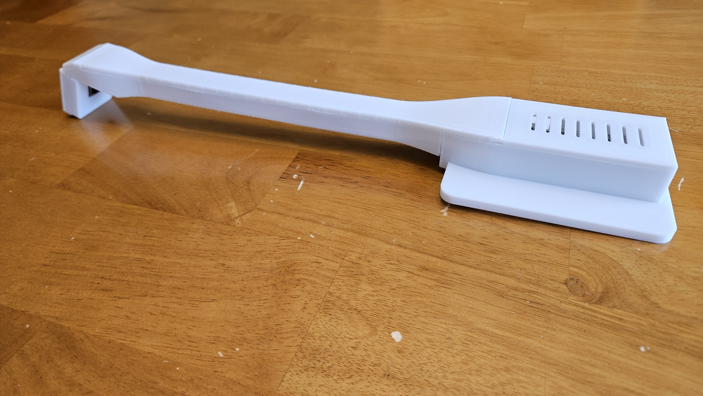
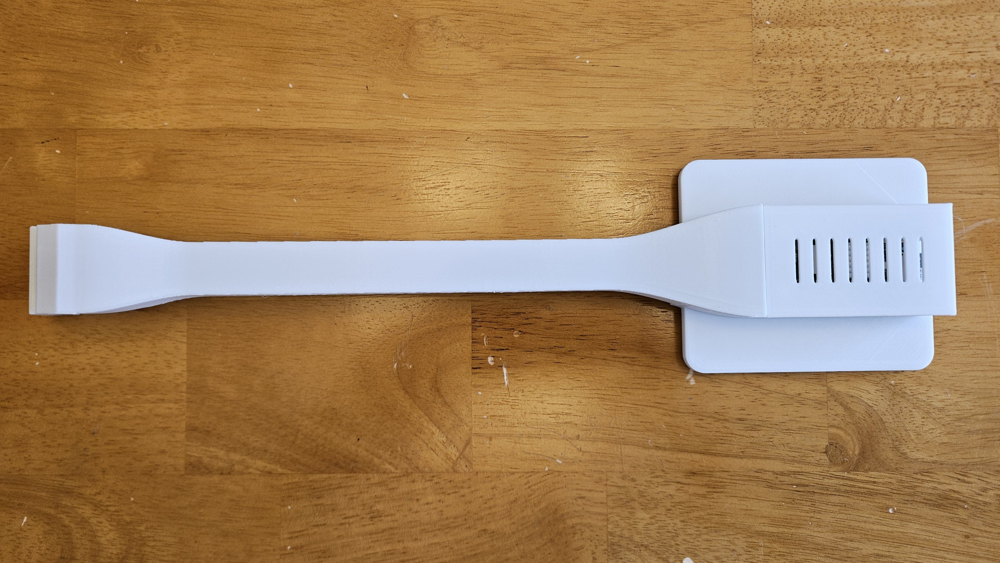
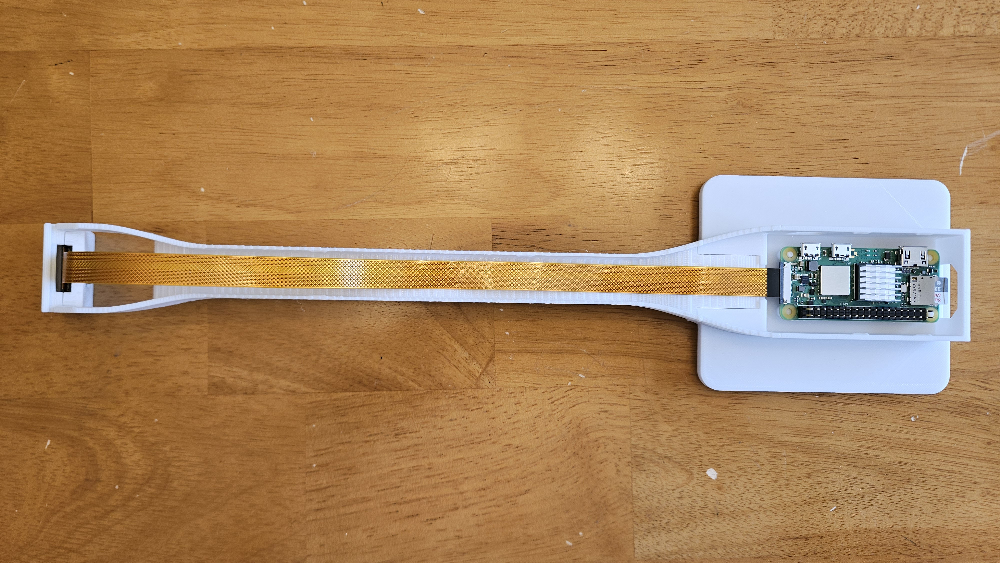
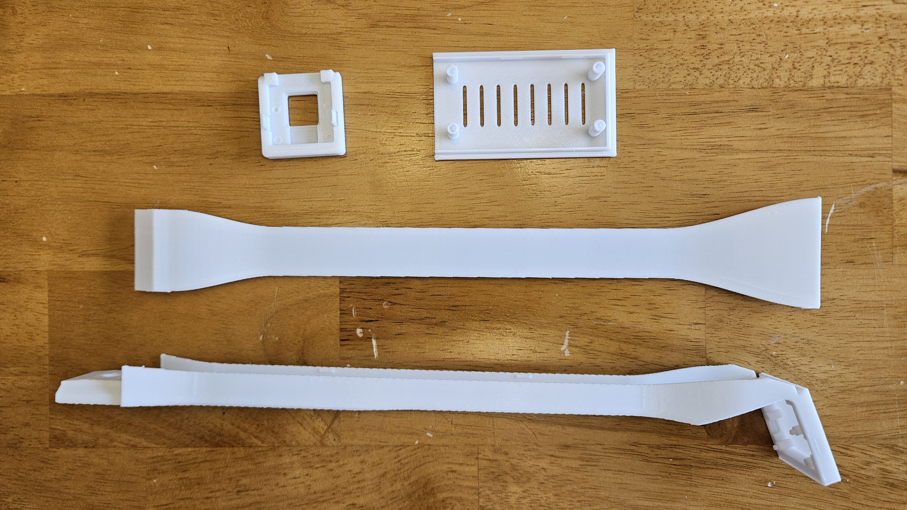
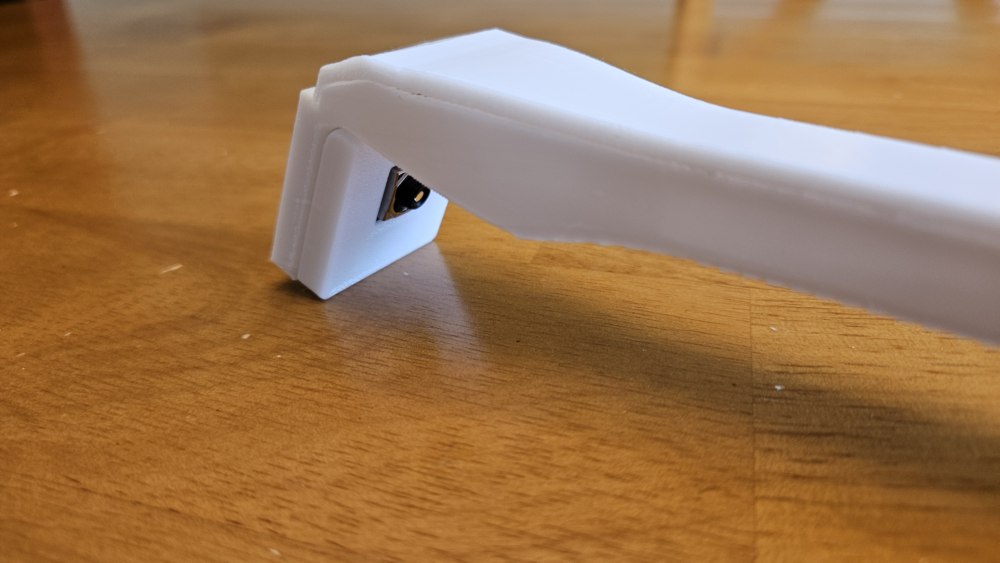

# Build photos

Supplied by the project owner for the model release. Full-resolution copies retain
the original pixels; EXIF/XMP/IPTC/comment metadata has been removed for publication.
The supplied originals have not been modified.

## Assembled view — suggested listing cover

## Top view with covers fitted

## Electronics and cable routing

## Printed components

## Camera end

